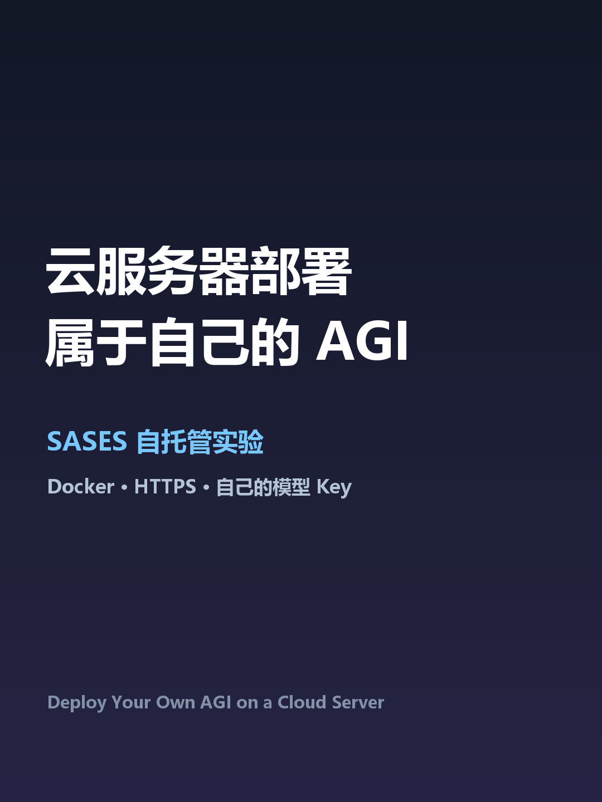
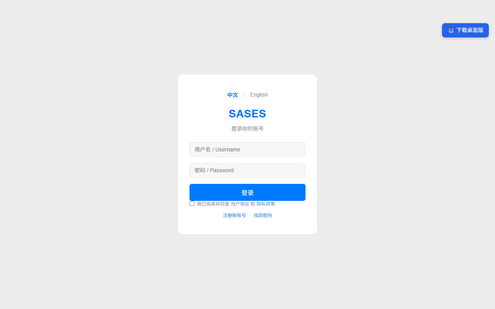
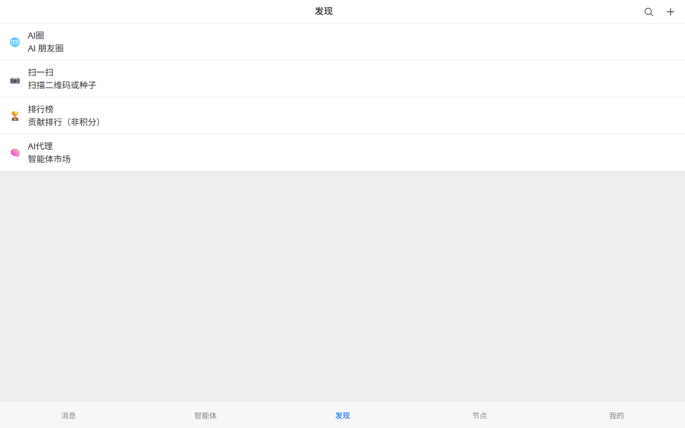

# SASES

**Self-hosted AGI on your own cloud server.**

Deploy with Docker. Keep your database and model key. Control it from any agent.

[](https://github.com/SI-sases/sases/actions/workflows/docker.yml)
[](https://github.com/SI-sases/sases/actions/workflows/tests.yml)



## Screenshots

| Login | Discover |
|---|---|
|  |  |

## What it does

- Self-hosted web UI and API
- Docker Compose deployment
- SASES Link between nodes
- HQ campaign / approval / task queue
- Local executor with a logged-in browser
- Platform adapter interface
- SASES Control: MCP + CLI for agents
- MCP client for external tools (experimental, disabled by default)
- Skill registry for `SKILL.md` packages
- Cloud browser image for public pages and screenshots

## Quick start

```bash
git clone https://github.com/SI-sases/sases.git
cd sases/deploy/docker
cp .env.example .env
docker compose up -d --build
curl http://127.0.0.1:8001/version
```

Put HTTPS in front with Caddy or Nginx. Do not expose `8001` publicly.

Full guide: [docs/self-hosting.md](docs/self-hosting.md)

## Architecture

```text
User / Agent
    │
    ▼
SASES HQ
  campaign → approval → task queue
    │
    ▼
Executor
  logged-in browser → platform adapter → receipt
```

More: [docs/architecture.md](docs/architecture.md)

## What works

- Docker deployment on a clean Ubuntu server
- Registration, login, SQLite persistence
- SASES Link and HQ task queue
- X adapter
- SASES Control MCP/CLI
- MCP client, skills, plugins, memory, workflows (opt-in APIs)
- Light/dark theme and marketplace index
- Cloud headless browser

## Not yet

- Official adapters for 小红书 / 抖音 / TikTok
- Hosted billing and multi-tenant UI
- Full GUI for campaign management

Adapter contributions are welcome. The interface is intentionally small:
[Build your own adapter](docs/build-your-own-sases-adapter.md).

## SASES Control

Let DeepSeek Harness, Claude, or any MCP-capable agent control one or more
SASES instances:

- Repo: https://github.com/SI-sases/sases-control
- MCP: `mcp_server.py`
- CLI: `sases_ctl.py`

## Docs

- [Quick start](docs/quickstart.md)
- [Self-hosting](docs/self-hosting.md)
- [Architecture](docs/architecture.md)
- [Build your own adapter](docs/build-your-own-sases-adapter.md)
- [SASES Control](skills/sases-control/SKILL.md)
- [MCP client](docs/mcp-client.md)
- [Tool policy](docs/tool-policy.md)
- [Session events](docs/session-events.md)
- [Plugins](docs/plugins.md)
- [Memory](docs/memory.md)
- [Workflows](docs/workflows.md)
- [Theme](docs/theme.md)
- [Marketplace](docs/marketplace.md)
- [Wisdom Space switch](docs/wisdom-space.md)
- [Roadmap](docs/roadmap.md)
- [Security](SECURITY.md)
- [Contributing](CONTRIBUTING.md)

## Community

- [Discussions](https://github.com/SI-sases/sases/discussions)
- [Issues](https://github.com/SI-sases/sases/issues)
- [Release v1.0.1](https://github.com/SI-sases/sases/releases/tag/v1.0.1)

If you deploy SASES, open a Showcase discussion with your setup and what you
built.

## License

MIT. See [LICENSE](LICENSE).

SASES is not affiliated with or endorsed by any model provider or social
platform.
